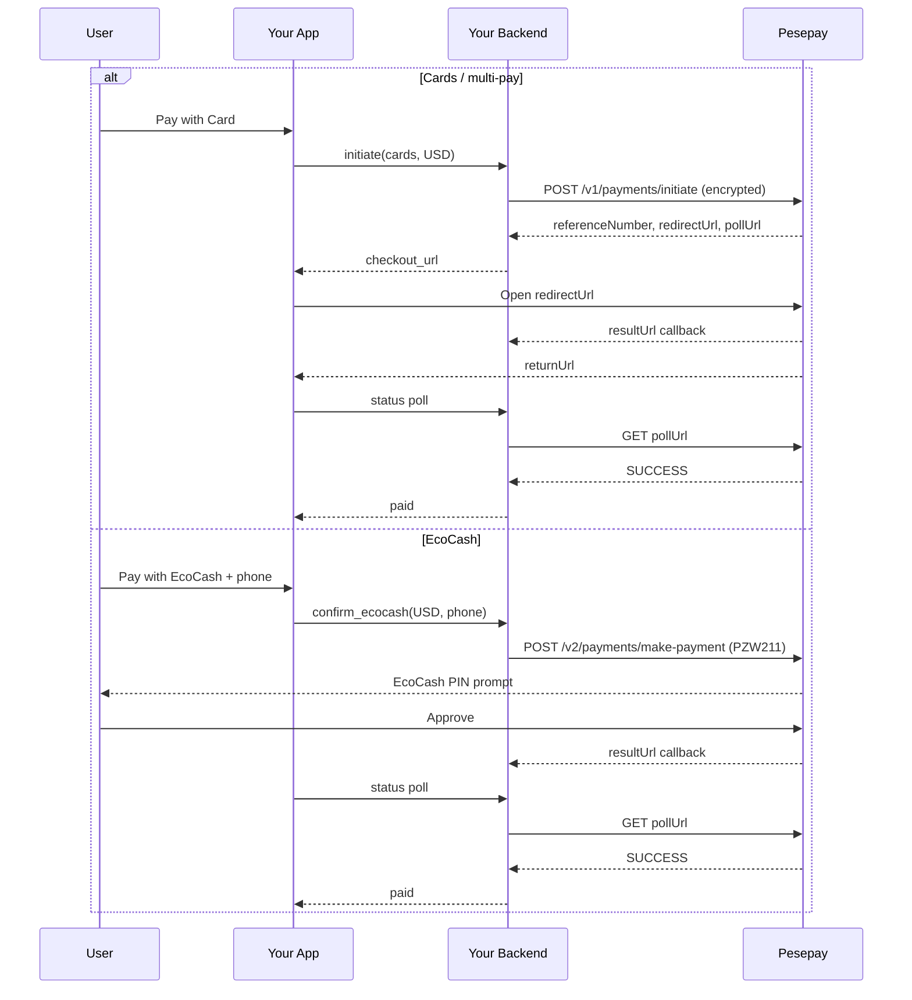

# Pesepay Integration Guide (USD) — EcoCash + Multi-Payment Checkout

Framework-agnostic guide for integrating **Pesepay** into another application using **USD**, with:

1. **EcoCash** — seamless (in-app) flow: user enters phone → PIN prompt on phone
2. **Multi-payment / Cards** — redirect (hosted) flow: Visa, Mastercard, Zimswitch, InnBucks, etc. on Pesepay’s page

> Confirm method codes and limits in your Pesepay dashboard.
> Live source of truth: **Get Payment Methods by Currency**.

Official docs: [Pesepay Developers](https://developers.pesepay.com/getting-started/overview/)

---

## 1. What you need from Pesepay

| Item | Purpose |
|------|---------|
| Integration key | Sent as `authorization` header on every API call |
| Encryption key | Exactly **32 characters** — AES-256-CBC for request/response payloads |
| Sandbox account | Test before production |
| Production account | Live keys after go-live checklist |

**Never** put keys in mobile apps or frontend. Keep them on your backend only.

### Environment variables (example)

```env
PESEPAY_ENABLED=true
PESEPAY_SANDBOX=true
PESEPAY_INTEGRATION_KEY=your_integration_key
PESEPAY_ENCRYPTION_KEY=your_32_character_secret!!

# USD for both flows
PESEPAY_CARDS_CHARGE_CURRENCY=USD
PESEPAY_ECOCASH_CHARGE_CURRENCY=USD

# EcoCash USD method code (confirm on your account)
PESEPAY_ECOCASH_METHOD_CODE=PZW211
```

---

## 2. Base URLs & endpoints

| Env | Base URL |
|-----|----------|
| Sandbox | `https://api.test.sandbox.pesepay.com/payments-engine` |
| Production | `https://api.pesepay.com/api/payments-engine` |

| Action | Method | Path |
|--------|--------|------|
| Initiate (redirect / multi-pay) | `POST` | `/v1/payments/initiate` |
| Make payment (seamless EcoCash) | `POST` | `/v2/payments/make-payment` |
| Check payment status | `GET` | `/v1/payments/check-payment?referenceNumber=...` |

Also: use the `pollUrl` returned by initiate / make-payment (preferred over building check-payment yourself).

### Headers (all calls)

```http
authorization: YOUR_INTEGRATION_KEY
Content-Type: application/json
Accept: application/json
```

Request body shape for initiate / make-payment:

```json
{ "payload": "<AES-256-CBC encrypted base64 string>" }
```

Response shape:

```json
{ "payload": "<encrypted base64 — decrypt to JSON>" }
```

---

## 3. Encryption (AES-256-CBC)

Pesepay encrypts every payment payload.

| Detail | Value |
|--------|-------|
| Algorithm | `AES-256-CBC` |
| Key | Your 32-char encryption key |
| IV (encrypt / normal decrypt) | First **16 characters** of the encryption key |
| Request encrypt output | Base64 ciphertext (OpenSSL default / options=`0`) |
| Response decrypt | Base64-decode ciphertext, then decrypt with `OPENSSL_RAW_DATA` |

### Pseudocode

```text
encrypt(jsonObject):
  iv = encryptionKey[0:16]
  plaintext = JSON.stringify(jsonObject)
  return openssl_encrypt(plaintext, AES-256-CBC, encryptionKey, base64Output=true, iv)

decrypt(encryptedBase64):
  iv = encryptionKey[0:16]
  cipherRaw = base64_decode(encryptedBase64)
  plaintext = openssl_decrypt(cipherRaw, AES-256-CBC, encryptionKey, raw=true, iv)
  return JSON.parse(plaintext)
```

**Quirk:** Check-payment / poll responses sometimes embed the IV as the first 16 bytes of the ciphertext. If normal decrypt fails, try:

```text
cipherRaw = base64_decode(payload)
iv = cipherRaw[0:16]
cipher = cipherRaw[16:]
decrypt(cipher, key, iv)
```

---

## 4. Payment method codes (USD)

| Method | USD code | Flow |
|--------|----------|------|
| **EcoCash** | `PZW211` | Seamless ✅ |
| InnBucks | `PZW212` | Seamless ✅ |
| Omari | `PZW216` | Seamless ✅ |
| **Zimswitch** | `PZW215` | Redirect only |
| **Visa** | `PZW204` | Redirect only |
| **Mastercard** | `PZW205` | Redirect only |

Cards / Zimswitch **cannot** use seamless — use **Initiate Transaction** (hosted page).

Source: [Payment method codes](https://developers.pesepay.com/resources/payment-method-codes/)

---

## 5. Recommended UX: two checkout buttons

```text
[ EcoCash ]                         → seamless flow (collect phone)
[ Card / Zimswitch / InnBucks ]     → redirect flow (hosted Pesepay page)
```

Charge currency for both: **`USD`**.

---

## 6. Flow A — Multi-payment (redirect / hosted checkout)

Use when the customer pays by **card, Zimswitch**, or picks a method on Pesepay’s page.

### Steps

1. Create a local pending order/payment row in your DB.
2. Call **Initiate Transaction** with encrypted body.
3. Store `referenceNumber` + `pollUrl`.
4. Redirect browser / WebView to `redirectUrl`.
5. Customer pays on Pesepay.
6. Pesepay hits your **`resultUrl`** (server callback) and sends browser to **`returnUrl`**.
7. On return / status poll: confirm `transactionStatus` is `SUCCESS` (or `PAID`), then mark order paid **idempotently**.

### Plaintext request (before encryption)

```json
{
  "amountDetails": {
    "amount": 10.00,
    "currencyCode": "USD"
  },
  "reasonForPayment": "Order #1042",
  "resultUrl": "https://yourapp.com/payments/pesepay/result?order_id=1042",
  "returnUrl": "https://yourapp.com/payments/pesepay/return?order_id=1042",
  "merchantReference": "order-1042"
}
```

Optional: set `paymentMethodCode` (e.g. `PZW204`) to open the hosted page on a specific method.

### Decrypted response

```json
{
  "referenceNumber": "…",
  "redirectUrl": "https://…",
  "pollUrl": "https://…"
}
```

Docs: [Initiate Transaction](https://developers.pesepay.com/api/initiate-transaction/)

### cURL sketch

```bash
# 1) Encrypt the JSON body with your AES helper → ENCRYPTED_PAYLOAD
curl -X POST "https://api.test.sandbox.pesepay.com/payments-engine/v1/payments/initiate" \
  -H "authorization: YOUR_INTEGRATION_KEY" \
  -H "Content-Type: application/json" \
  -H "Accept: application/json" \
  -d '{"payload":"ENCRYPTED_PAYLOAD"}'
```

---

## 7. Flow B — EcoCash (seamless / direct)

Use when the customer pays with **EcoCash USD** from your own UI.

### Steps

1. Create local pending order.
2. Collect EcoCash MSISDN (e.g. `0771234567`).
3. Call **Make Payment** (`/v2/payments/make-payment`) with method `PZW211`.
4. Store `referenceNumber` + `pollUrl`.
5. Show “Approve the EcoCash prompt on your phone”.
6. Poll `pollUrl` (or wait for `resultUrl` callback).
7. When status is `SUCCESS` / `PAID`, mark order paid.

> **A HTTP 200 from Make Payment does NOT mean you were paid.**
> Only a terminal `transactionStatus` of **`SUCCESS`** (via callback or check-payment) means paid.

Docs: [Seamless flow](https://developers.pesepay.com/payments/seamless-flow/)

### Plaintext request (before encryption)

```json
{
  "amountDetails": {
    "amount": 10.00,
    "currencyCode": "USD"
  },
  "merchantReference": "order-1042",
  "reasonForPayment": "Order #1042",
  "resultUrl": "https://yourapp.com/payments/pesepay/result?order_id=1042",
  "returnUrl": "https://yourapp.com/payments/pesepay/return?order_id=1042",
  "paymentMethodCode": "PZW211",
  "customer": {
    "email": "buyer@example.com",
    "phoneNumber": "0771234567",
    "name": "Buyer Name"
  },
  "paymentMethodRequiredFields": {
    "customerPhoneNumber": "0771234567"
  }
}
```

EcoCash required field: **`customerPhoneNumber`**.

### Typical response fields (decrypt)

```json
{
  "referenceNumber": "…",
  "pollUrl": "https://…",
  "transactionStatus": "PENDING",
  "transactionStatusCode": 0
}
```

---

## 8. Confirming payment status

### Preferred: GET the `pollUrl`

```http
GET {pollUrl}
authorization: YOUR_INTEGRATION_KEY
Accept: application/json
```

Decrypt `payload`. Treat as paid when:

```text
transactionStatus ∈ { "SUCCESS", "PAID" }   (case-insensitive)
```

### Alternative: Check Payment

```http
GET {base}/v1/payments/check-payment?referenceNumber={ref}
authorization: YOUR_INTEGRATION_KEY
```

### Polling strategy (client / server)

After EcoCash or return from hosted page:

| Attempt | Delay |
|---------|-------|
| 1 | 1.5s |
| 2 | 2.5s |
| 3 | 3.5s |
| 4 | 4.5s |
| 5 | 6s |
| 6 | 8s |

Stop when status is terminal (`SUCCESS` / `PAID` / `FAILED` / `CANCELLED`) or attempts exhausted → show “still pending, try again shortly”.

---

## 9. `returnUrl` vs `resultUrl`

| URL | Who hits it | Purpose |
|-----|-------------|---------|
| **`returnUrl`** | Customer browser / WebView | UX: “Payment complete / pending” page |
| **`resultUrl`** | Pesepay server → your server | Authoritative webhook / result POST |

**Best practice**

- On `resultUrl`: decrypt/verify, mark order paid **idempotently**, return `200`.
- On `returnUrl`: poll status once, then show UI. Do **not** trust query `?status=success` alone.
- Never fulfil goods/services until you see terminal **SUCCESS** from poll/callback.

---

## 10. Suggested database fields (per payment)

| Column | Notes |
|--------|-------|
| `id` | Your primary key |
| `public_ref` | UUID for client polling |
| `amount_usd` | Decimal |
| `currency` | `USD` |
| `payment_method` | `ecocash` \| `cards` |
| `payment_provider` | `pesepay` |
| `provider_reference` | Pesepay `referenceNumber` |
| `status` | `pending` \| `paid` \| `failed` |
| `paid_at` | nullable timestamp |
| `metadata` | JSON: `poll_url`, `redirect_url`, `ecocash_msisdn`, raw response bits |

---

## 11. Backend API shape you can expose to your app

### Initiate cards / multi-pay

`POST /api/payments/initiate`

```json
{
  "payment_method": "cards",
  "amount_usd": 10.00,
  "order_id": 1042
}
```

Response `201`:

```json
{
  "next": "webview",
  "checkout_url": "https://pesepay-redirect…",
  "payment": {
    "id": 1,
    "public_ref": "uuid",
    "status": "pending",
    "amount_usd": 10.00
  }
}
```

### Initiate EcoCash (create pending + prepare)

`POST /api/payments/initiate`

```json
{
  "payment_method": "ecocash",
  "amount_usd": 10.00,
  "order_id": 1042,
  "ecocash_msisdn": "0771234567"
}
```

Response:

```json
{ "next": "confirm_ecocash", "payment": { "…" } }
```

### Confirm EcoCash (calls Make Payment)

`POST /api/payments/confirm-ecocash`

Then poll:

`GET /api/payments/{id}/status?public_ref=…`

```json
{
  "payment": { "status": "paid" },
  "paid": true
}
```

---

## 12. Mobile / WebView notes

### Cards (redirect)

1. Open `checkout_url` in a WebView / browser.
2. Intercept navigation to your `returnUrl` (or custom scheme).
3. Close WebView and poll your status endpoint.

### EcoCash (seamless)

1. Collect phone in your UI.
2. Call confirm-ecocash.
3. Show spinner + “Enter your EcoCash PIN when prompted”.
4. Poll until paid / failed / timeout.

---

## 13. PHP crypto helpers (drop-in)

```php
<?php

final class PesepayCrypto
{
    private const ALGO = 'AES-256-CBC';

    public function __construct(private string $encryptionKey)
    {
        if (mb_strlen($this->encryptionKey) !== 32) {
            throw new RuntimeException('Encryption key must be exactly 32 characters.');
        }
    }

    public function encrypt(array $payload): string
    {
        $iv = substr($this->encryptionKey, 0, 16);
        $json = json_encode($payload, JSON_UNESCAPED_SLASHES);
        $encrypted = openssl_encrypt($json, self::ALGO, $this->encryptionKey, 0, $iv);
        if ($encrypted === false) {
            throw new RuntimeException('Encrypt failed');
        }

        return $encrypted;
    }

    public function decrypt(string $encryptedBase64): array
    {
        $iv = substr($this->encryptionKey, 0, 16);
        $cipherRaw = base64_decode($encryptedBase64, true);
        if ($cipherRaw === false) {
            throw new RuntimeException('Invalid base64');
        }

        $decrypted = openssl_decrypt($cipherRaw, self::ALGO, $this->encryptionKey, OPENSSL_RAW_DATA, $iv);
        if ($decrypted === false) {
            // Embedded-IV fallback (check-payment quirk)
            $iv = substr($cipherRaw, 0, 16);
            $cipher = substr($cipherRaw, 16);
            $decrypted = openssl_decrypt($cipher, self::ALGO, $this->encryptionKey, OPENSSL_RAW_DATA, $iv);
        }

        if ($decrypted === false) {
            throw new RuntimeException('Decrypt failed');
        }

        $data = json_decode($decrypted, true);
        if (! is_array($data)) {
            throw new RuntimeException('Invalid JSON after decrypt');
        }

        return $data;
    }
}
```

---

## 14. Node.js crypto helpers (sketch)

```js
const crypto = require('crypto');

function encrypt(obj, key32) {
  const iv = Buffer.from(key32.slice(0, 16), 'utf8');
  const cipher = crypto.createCipheriv('aes-256-cbc', Buffer.from(key32, 'utf8'), iv);
  const json = JSON.stringify(obj);
  return Buffer.concat([cipher.update(json, 'utf8'), cipher.final()]).toString('base64');
}

function decrypt(encryptedBase64, key32) {
  const iv = Buffer.from(key32.slice(0, 16), 'utf8');
  const data = Buffer.from(encryptedBase64, 'base64');
  try {
    const decipher = crypto.createDecipheriv('aes-256-cbc', Buffer.from(key32, 'utf8'), iv);
    const out = Buffer.concat([decipher.update(data), decipher.final()]);
    return JSON.parse(out.toString('utf8'));
  } catch {
    const embeddedIv = data.subarray(0, 16);
    const cipher = data.subarray(16);
    const decipher = crypto.createDecipheriv('aes-256-cbc', Buffer.from(key32, 'utf8'), embeddedIv);
    const out = Buffer.concat([decipher.update(cipher), decipher.final()]);
    return JSON.parse(out.toString('utf8'));
  }
}
```

---

## 15. Idempotent “mark paid” rules

```text
IF order.status == paid → no-op (still return success)
ELSE:
  set status=paid, paid_at=now()
  deliver product / unlock / email (once)
```

Always re-check Pesepay status before marking paid if the request came only from the browser return URL.

---

## 16. Sandbox → production checklist

- [ ] Sandbox end-to-end: EcoCash + cards
- [ ] `resultUrl` reachable publicly over HTTPS
- [ ] Amounts/limits verified for `PZW211` USD
- [ ] Encryption key length = 32
- [ ] Switch `PESEPAY_SANDBOX=false` and production keys
- [ ] Base URL → production
- [ ] Logging (no secrets in logs)
- [ ] Never fulfil on initiate / make-payment `200` alone

---

## 17. Common mistakes

| Mistake | Fix |
|---------|-----|
| Charging ZWG while UI says USD | Set `currencyCode: "USD"` for both flows |
| Using Visa code in seamless | Use redirect initiate for cards |
| Trusting return URL query only | Always poll / wait for result callback |
| Wrong EcoCash code for USD | Use `PZW211` (not ZiG `PZW201`) |
| Encryption key ≠ 32 chars | Reject at boot |
| Putting keys in Expo / React Native | Proxy all Pesepay calls via your API |
| Sandbox make-payment on `/v1/...` | Use `/v2/payments/make-payment` |

---

## 18. Decision tree

```text
Customer chooses payment method
├─ EcoCash
│   └─ Collect phone → POST make-payment (PZW211, USD)
│       → poll until SUCCESS / FAILED
└─ Cards / Zimswitch / “other”
    └─ POST initiate (USD) → open redirectUrl
        → on return, poll until SUCCESS / FAILED
```

---

## 19. Official links

- Overview: https://developers.pesepay.com/getting-started/overview/
- Initiate: https://developers.pesepay.com/api/initiate-transaction/
- Seamless: https://developers.pesepay.com/payments/seamless-flow/
- Method codes: https://developers.pesepay.com/resources/payment-method-codes/
- OpenAPI: https://developers.pesepay.com/openapi.yaml
- Postman: https://developers.pesepay.com/postman/pesepay.postman_collection.json

---

## 20. Minimal sequence diagram


